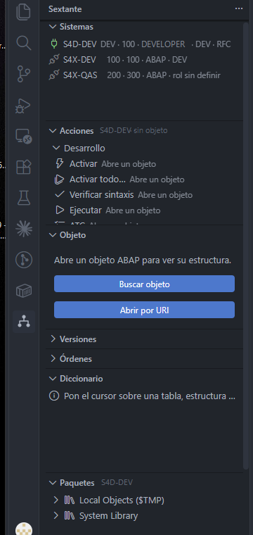
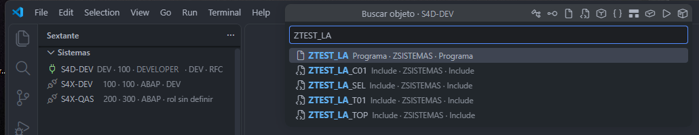
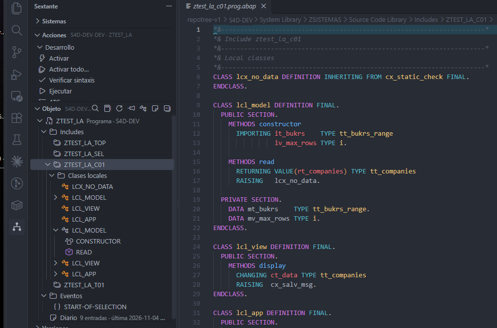
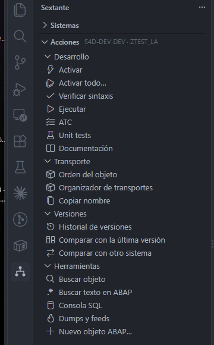
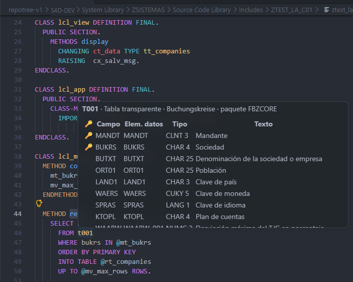
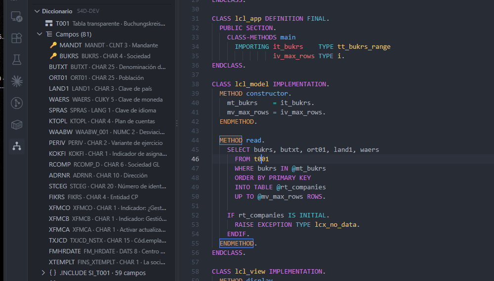
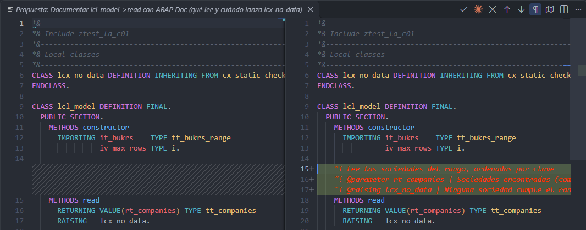

# Sextante

[English](README.md) · **Español**

**Una cara tipo SAP GUI (SE80) dentro de VS Code**, montada encima de la extensión oficial de SAP
"ABAP Development Tools for Visual Studio Code". Un panel lateral siempre visible donde eliges el
sistema, buscas un objeto por nombre, ves su estructura como árbol y actúas con botones visibles.
Sextante solo navega, muestra estado y dispara los comandos de la extensión oficial: editar,
activar, bloquear y depurar lo sigue haciendo ella.

> Versión preliminar (preview). Pensada para desarrolladores ABAP que trabajan con varios
> sistemas S/4HANA. No está afiliada a SAP SE ni respaldada por ella.

## Requisitos

- VS Code 1.100 o superior.
- La extensión **ABAP Development Tools for Visual Studio Code** de SAP (`sapse.adt-vscode`),
  instalada desde el Marketplace. Si falta, Sextante lo avisa y ofrece instalarla. Sextante lee de
  ella la lista de destinos (`destinations.json`) y usa su sistema de archivos `abap:`; no hay una
  lista de sistemas propia.
- Un sistema **S/4HANA** al que la extensión oficial pueda conectarse. ECC queda fuera de alcance.

## Tutorial rápido

Dentro de VS Code tienes este mismo recorrido: `Ctrl+Shift+P` → **Welcome: Open Walkthrough…** → **Primeros pasos con
Sextante**.

**1. Conecta un sistema.** Abre Sextante en la barra lateral. Los sistemas salen de la extensión oficial; la
primera vez indicas su rol (DEV, QAS o PRD) y te conectas con tu usuario.

**2. Busca un objeto.** Botón **Buscar objeto** o `Sextante: Buscar objeto`: programas, clases, includes, tablas,
funciones y transacciones por nombre.

**3. Recorre su estructura.** La vista Objeto muestra includes, clases locales, métodos y eventos, como SE80. Un
clic lleva al código.

**4. Actúa con un clic.** Activar, Activar todo, Verificar sintaxis, ATC, Unit tests, transporte y versiones, siempre
a la vista.

**5. El diccionario en contexto.** Pasa el ratón sobre una tabla o un campo para ver su estructura; el panel
Diccionario la deja fija y genera `TYPES`, `SELECT` y `DATA`.

**6. Trabaja con un agente de IA.** Conecta Claude Code con `Sextante: Conectar el agente (Claude Code)`. El agente
propone cada cambio como un diff y tú decides con **Aplicar** o **Rechazar**.

## Qué hace

**Sistemas.** Lista tus destinos y, la primera vez, pregunta el rol de cada uno: DEV, QAS o PRD.
Nada más que configurar. Muestra qué vía usa para la búsqueda rápida y el diccionario.

**Buscar objeto.** `Sextante: Buscar objeto` abre una búsqueda rápida por nombre (programas,
clases, interfaces, tablas, módulos de funciones, transacciones…). También buscar texto en ABAP.

**Objeto.** Árbol del objeto abierto al estilo SE80 / SE24: componentes, métodos, includes, con
salto al código. Puedes fijar el objeto y abrir los métodos como bloque. **Ctrl+clic** (o F12) sobre un
`PERFORM` lleva a su `FORM`, aunque esté en otro include del programa, como el doble clic de SE80; con el
modo bloque activo se abre como bloque. Para volver, **Alt+Flecha izquierda** (nativo de VS Code).

**Acciones.** Botones sobre el objeto activo: Activar, Activar todo…, Verificar sintaxis, ATC, Unit tests,
Transporte, Comparar con la última versión o con otro sistema, Ejecutar, Documentación e
Historial de versiones. Son los comandos de la extensión oficial, un clic más cerca.

**Paquetes.** Explorador de paquetes del sistema activo.

**Diccionario en contexto.** Al pasar el ratón sobre una tabla, un campo, un elemento de datos,
un dominio, un mensaje, un módulo de funciones o un método, ves su definición. El panel
Diccionario permite "Ver datos" (Data Preview, solo tablas), "Dónde se usa" acotado a tus objetos
propios y generar `TYPES`, `SELECT` o `DATA` en el cursor.

**Consola SQL** con identificadores validados (nunca texto libre), **Dumps y feeds** del sistema y
**Nuevo objeto ABAP** guiado.

**Agente de IA.** Sextante incluye un servidor MCP local (solo `127.0.0.1`, con token) para que Claude
Code u otro cliente MCP vea lo que tú: el objeto abierto, el cursor, el programa completo con sus
includes y la estructura, y pueda abrir objetos y transacciones en tu editor. El agente propone cada cambio de
código como un diff que tú aplicas o rechazas, verifica la sintaxis, lanza unit tests y ATC, consulta el sistema
(release y componentes), pide objetos nuevos por el asistente de la oficial y deja un diario por objeto. La escritura
es solo para sistemas DEV y activar siempre pide tu confirmación. Se conecta con `Sextante: Conectar el agente
(Claude Code)`; la guía está en [docs/agente-ia.md](docs/agente-ia.md).

**Tema "Sextante Oscuro"** con paleta One Dark y gramáticas propias para ABAP y ABAP SQL. Es
opcional: la extensión te lo propone una vez.

## Cómo se conecta

Sextante no te pide elegir vía. Por sistema decide sola:

1. **RFC**, si el destino es `protocol: rfc` y están el JRE y el JCo que instala la extensión
   oficial. Solo en **Windows**.
2. **REST** por HTTP directo a ADT, si hay una URL guardada o un candidato responde.
3. El **buscador de la extensión oficial**, en cualquier otro caso.

Los destinos con SSO/SNC no usan ni RFC ni REST propios. BTP (OAuth) no está soportado para la
conexión propia.

## Seguridad y privacidad

- En sistemas con rol **QAS o PRD** el código se abre en **solo lectura** y los botones Activar,
  Activar todo…, Bloquear y Transporte se deshabilitan. Es una red de seguridad, no un control de acceso.
- Las contraseñas de la conexión propia se guardan únicamente en el almacén seguro de VS Code.
  Nunca en settings, archivos ni logs.
- Por RFC, en QAS/PRD solo pasan lecturas; cualquier escritura se rechaza.
- **Sin telemetría.** Sextante no envía nada a ningún servidor que no sea tu sistema SAP.
- El registro (Output Channel "Sextante") solo contiene la forma de las peticiones y conteos.

## Configuración

Casi ninguna. Por sistema se pregunta una vez el rol y, si se usa la búsqueda REST, la
contraseña. Los prefijos de objetos propios (por defecto `Z` e `Y`) se amplían desde el propio
panel Diccionario con "Añadir a prefijos propios".

## Limitaciones conocidas

- La vía RFC existe solo en Windows; en macOS y Linux se usa REST o el buscador de la oficial.
- Sin SSO/SNC ni BTP para la conexión propia.
- Solo S/4HANA, porque la extensión oficial no soporta ECC.

## Licencia

Software libre bajo la licencia MIT (archivo `LICENSE.md`): puedes usarlo, copiarlo, modificarlo y redistribuirlo, también con
fines comerciales, manteniendo el aviso de copyright. Es un aporte a la comunidad SAP de Lennin Rodriguez,
desarrollador SAP ABAP de Honduras.

Sextante requiere la extensión oficial "ABAP Development Tools for Visual Studio Code" de SAP SE, que se instala por
separado bajo su propia licencia; Sextante no incluye ni redistribuye componentes de SAP. SAP, ABAP y S/4HANA son
marcas de SAP SE; se mencionan únicamente para describir la compatibilidad. Sextante no está afiliado a SAP SE ni
respaldado por ella.
