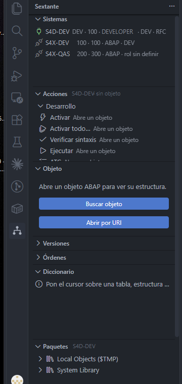
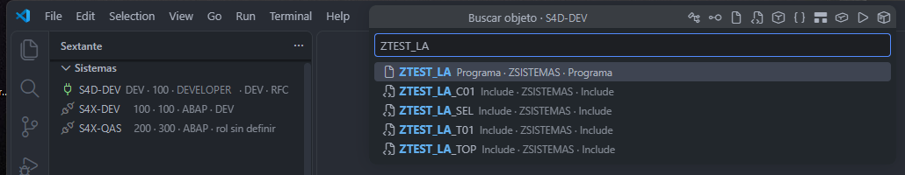
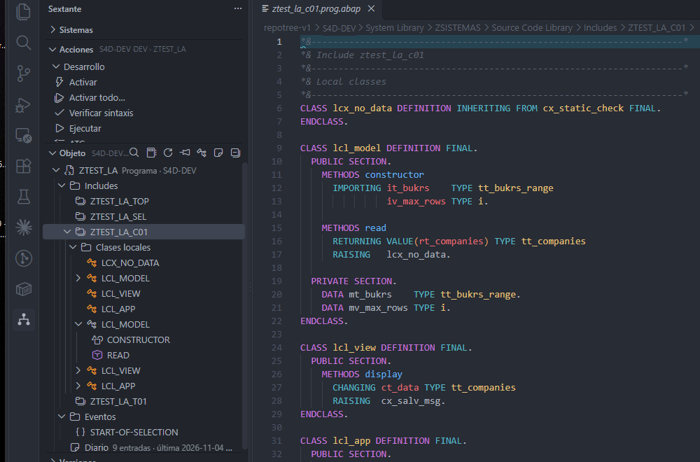
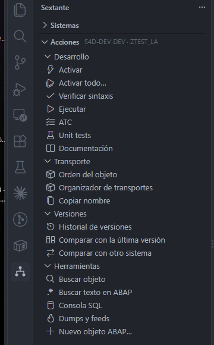
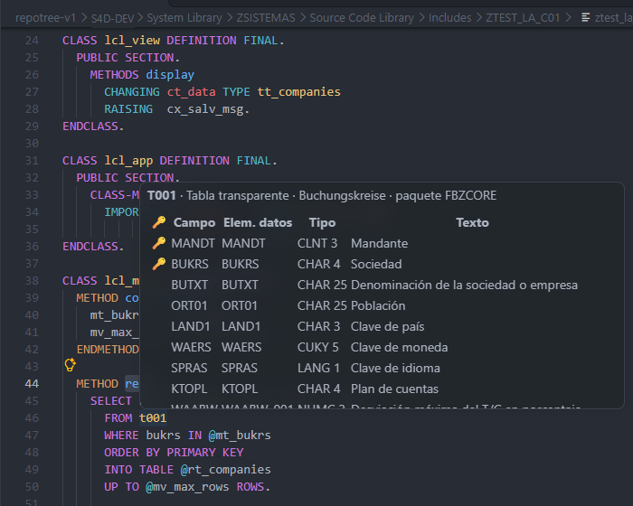
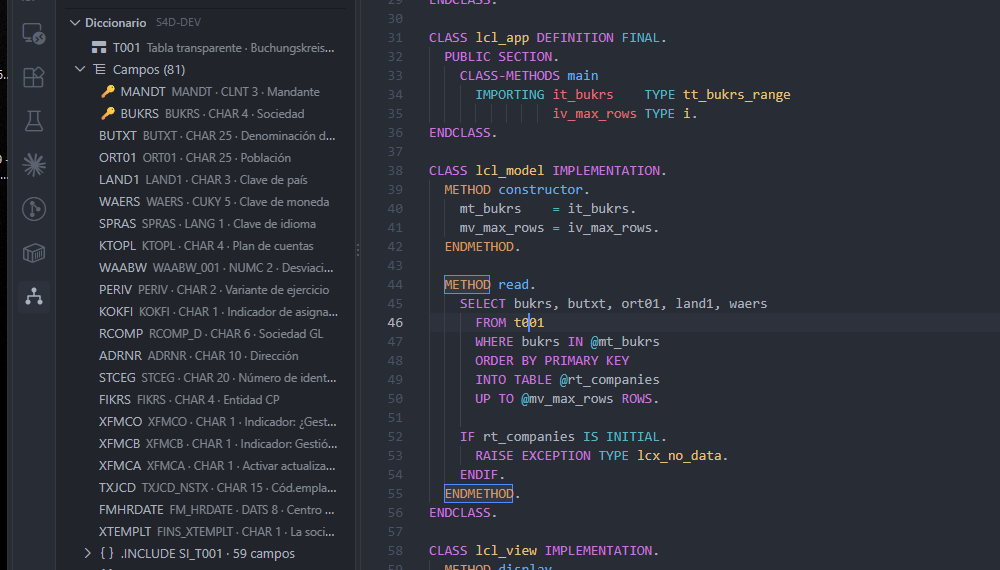
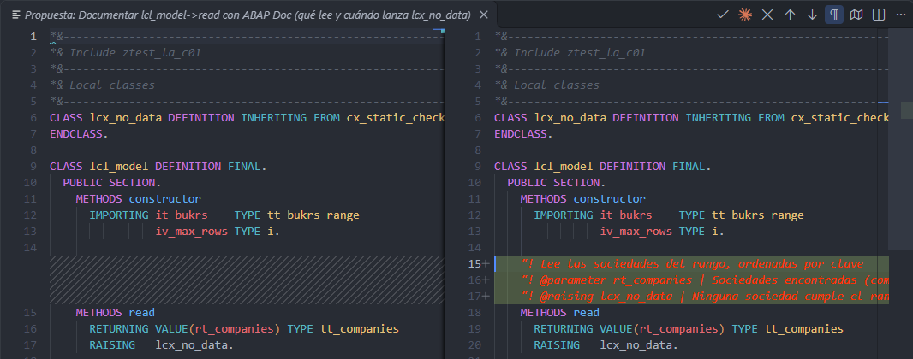

# Sextante

**English** · [Español](README.es.md)

**An SAP GUI (SE80)-style workbench inside VS Code**, built on top of SAP's official extension
"ABAP Development Tools for Visual Studio Code". An always-visible side panel where you pick the
system, search an object by name, see its structure as a tree and act with visible buttons.
Sextante only navigates, shows status and triggers the official extension's commands: editing,
activating, locking and debugging are still done by it.

> Preview release. Built for ABAP developers who work across several S/4HANA systems.
> The user interface is currently in Spanish; English is planned.
> Not affiliated with or endorsed by SAP SE.

## Requirements

- VS Code 1.100 or later (also works in VS Code-based editors that install from Open VSX).
- SAP's **ABAP Development Tools for Visual Studio Code** extension (`sapse.adt-vscode`). If it is
  missing, Sextante tells you and offers to install it. Sextante reads its list of destinations
  (`destinations.json`) and uses its `abap:` file system; there is no separate list of systems.
- An **S/4HANA** system the official extension can connect to. ECC is out of scope.

## Quick tutorial

The same tour is available inside VS Code: `Ctrl+Shift+P` → **Welcome: Open Walkthrough…** → **Primeros pasos con
Sextante**.

**1. Connect a system.** Open Sextante in the activity bar. Systems come from the official extension; the first
time you set each one's role (DEV, QAS or PRD) and log on with your user.

**2. Find an object.** **Buscar objeto** button or `Sextante: Buscar objeto`: programs, classes, includes, tables,
function modules and transactions by name.

**3. Walk its structure.** The Object view shows includes, local classes, methods and events, like SE80. One click
takes you to the code.

**4. Act in one click.** Activate, Activate all, Check syntax, ATC, Unit tests, transport and versions, always in
sight.

**5. Dictionary in context.** Hover a table or a field to see its structure; the Dictionary panel keeps it pinned and
generates `TYPES`, `SELECT` and `DATA`.

**6. Work with an AI agent.** Connect Claude Code with `Sextante: Conectar el agente (Claude Code)`. The agent
proposes every change as a diff and you decide with **Aplicar** (apply) or **Rechazar** (reject).

## What it does

**Systems.** Lists your destinations and, the first time, asks each one's role: DEV, QAS or PRD.
Nothing else to configure. Shows which channel it uses for quick search and the dictionary.

**Find object.** Quick search by name (programs, classes, interfaces, tables, function modules,
transactions…), plus full-text search in ABAP.

**Object.** SE80 / SE24-style tree of the open object: components, methods, includes, with a jump
to the code. Pin the object and open methods as a block. **Ctrl+click** (or F12) on a `PERFORM`
goes to its `FORM`, even in another include of the program, like SE80's double click. **Alt+Left
Arrow** takes you back.

**Actions.** Buttons on the active object: Activate, Activate all…, Check syntax, ATC, Unit tests,
Transport, Compare with the last version or with another system, Execute, Documentation and
Version history. They are the official extension's commands, one click closer.

**Packages.** Package explorer for the active system.

**Dictionary in context.** Hover a table, field, data element, domain, message, function module or
method to see its definition. The Dictionary panel adds "Ver datos" (data preview, tables only),
where-used limited to your own objects, and generates `TYPES`, `SELECT` or `DATA` at the cursor.

**Transport requests, versions and monitor.** Your transport requests per system and the request of
the open object; version history with diffs; compare the same object across DEV / QAS / PRD;
today's short dumps (ST22) summarized with jumps to the code; inactive objects.

**SQL console** with validated identifiers (never free text) and a guided **New ABAP object**.

**AI agent.** Sextante ships a local MCP server (`127.0.0.1` only, token-protected) so Claude Code or
any MCP client sees what you see: the open object, the cursor, the whole program with its includes
and its structure. The agent proposes every code change as a diff you apply or reject, checks syntax,
runs unit tests and ATC, queries the system (release and components), requests new objects through the
official wizard and keeps a journal per object. Writing is allowed only on DEV systems and activation
always asks for your confirmation. Guide: [docs/agente-ia.md](docs/agente-ia.md) (Spanish).

**"Sextante Oscuro" theme** with a One Dark palette and grammars for ABAP and ABAP SQL. Optional:
the extension suggests it once.

## How it connects

You never pick a channel. Per system, Sextante decides:

1. **RFC**, when the destination is `protocol: rfc` and the JRE and JCo installed by the official
   extension are present. **Windows** only.
2. **REST** over direct HTTP to ADT, when a URL is saved or a candidate answers.
3. The **official extension's search**, otherwise.

Destinations with SSO/SNC use neither its own RFC nor REST. BTP (OAuth) is not supported for its own
connection.

## Security and privacy

- On systems with role **QAS or PRD**, code opens **read-only** and Activate, Activate all…, Lock and
  Transport are disabled. A safety net, not access control.
- Passwords for its own connection are stored only in VS Code's secret storage. Never in settings,
  files or logs.
- Over RFC, QAS/PRD only allow reads; any write is rejected.
- **No telemetry.** Sextante sends nothing anywhere except your SAP system.
- The log (Output channel "Sextante") only holds the shape of requests and counts.

## Configuration

Almost none. Each system asks once for its role and, if REST search is used, the password. Your own
object prefixes (`Z` and `Y` by default) are extended from the Dictionary panel with "Añadir a
prefijos propios".

## Known limitations

- The RFC channel exists only on Windows; macOS and Linux use REST or the official search.
- No SSO/SNC or BTP for its own connection.
- S/4HANA only, because the official extension does not support ECC.
- User interface in Spanish for now.

## License

Free and open source under the MIT license (`LICENSE.md`): use, copy, modify and redistribute it, commercially
too, keeping the copyright notice. A contribution to the SAP community by Lennin Rodriguez, SAP ABAP developer
from Honduras.

Sextante requires SAP SE's official "ABAP Development Tools for Visual Studio Code" extension, installed
separately under its own license; Sextante does not include or redistribute any SAP component. SAP, ABAP and
S/4HANA are trademarks of SAP SE, mentioned only to describe compatibility. Sextante is not affiliated with or
endorsed by SAP SE.
